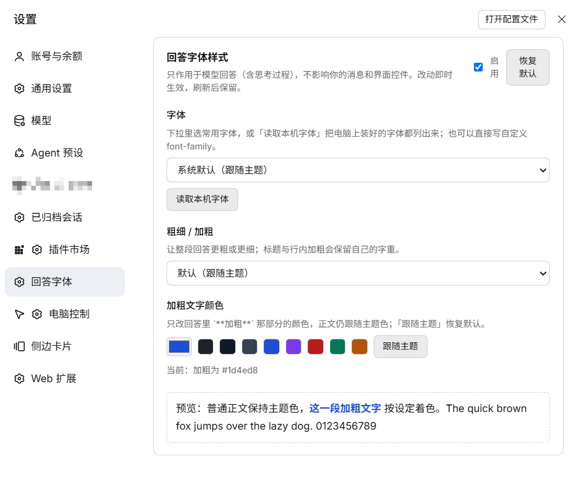

# dsh-answer-style · Answer Typography

[中文](README.md) | English

Restyle **only the model's answers** in DeepSeek Harness (DSH): **font family / overall weight / bold-text color**, with a one-click reset.

> Your own messages, tool rows, the composer and the sidebar keep the theme. The color applies to `**bold**` runs only — body text stays the theme color.

<p align="left">
  <a href="https://www.npmjs.com/package/dsh-answer-style"></a>
  
  
  
  
</p>

## Screenshots

| Settings panel | Font menu |
| --- | --- |
|  |  |


## Why

DSH's built-in appearance settings change the whole interface at once — sidebar, buttons and composer included. Often you only want your *reading* of the answer to feel better, or the key conclusions to stand out. This plugin keeps the scope strictly on the assistant row.

## Features

| Setting | What it does |
| --- | --- |
| Enable | Master switch; turning it off restores the theme instantly and keeps your preferences |
| Font | Curated stacks (Microsoft YaHei, PingFang, Source Han Sans, LXGW WenKai, KaiTi, SimSun, DengXian, monospace, serif) · **Load installed fonts** via the Local Font Access API · or type a custom `font-family` list |
| Overall weight | Default (theme) / 300 / 400 / 500 / 600 / 700. Headings and `**bold**` keep their own weight |
| Bold text color | Colors **only** `**bold**` runs; body text keeps the theme color. Color picker + 8 presets, “Follow theme” resets |
| Reset | Clears every preference and removes the injected stylesheet |

- **Scope:** the assistant body of chat rows, including reasoning text, lists, tables and headings
- **Live:** changes apply immediately, with a preview row at the bottom of the panel
- **Persisted:** per browser in `localStorage` (`dsh-answer-style/v1`)
- **Lightweight:** zero runtime dependencies, no build step, no bundled fonts, no network, no telemetry

## Install

```sh
# npm
dsh plugin --profile web add dsh-answer-style

# GitHub
dsh plugin --profile web add github:Luoqiaocong/dsh-answer-style
```

Reload the page afterwards. If **Settings → 回答字体** is missing, restart `dsh web` (or DSH Desktop) once.

Manual install: copy the package into `~/.dsh/profiles/web/node_modules/dsh-answer-style` and append to `~/.dsh/profiles/web/cordis.patch.yml`:

```yaml
- insert:
    - id: answer-style
      name: dsh-answer-style
```

### DSH Desktop

```sh
dsh plugin --profile desktop add dsh-answer-style
```

Electron has no `window.queryLocalFonts`, so “Load installed fonts” reports it as unavailable — type the family name instead. Preferences live in the Electron profile's own `localStorage`, independent from the browser.

## Usage

Open **Settings → 回答字体**, pick a font (or load local fonts), adjust the overall weight, and choose a color for bold runs — blue `#1d4ed8`, for example. **Reset** restores the original look.

## Compatibility

| Item | Detail |
| --- | --- |
| Minimum DSH | `0.2.2-rc.1` (`dsh.engines.dsh`, enforced by the plugin manager) |
| Version range | `0.2.x` |
| Web GUI | modern Chrome / Edge / Firefox / Safari |
| DSH Desktop | yes — install into the `desktop` profile |
| OS | Windows / macOS / Linux; fonts follow the machine |
| Runtime dependencies | none |

## How it works

The client half registers the `settings.section` slot and rebuilds a single stylesheet:

```css
[data-chat-flow-kind="assistant-step"] [class*="_markdown_"],
[data-chat-flow-kind="assistant-step"] :is(p, li, blockquote, dd, dt, figcaption, th, td) {
  font-family: "LXGW WenKai", serif !important;
}

/* bold runs only — body text untouched */
[data-chat-flow-kind="assistant-step"] :is(strong, b) {
  color: #1d4ed8 !important;
}
```

`[data-chat-flow-kind="assistant-step"]` is the stable anchor of one assistant answer row, so user messages and UI chrome are untouched. Code blocks keep their own monospace font and color. Reset simply removes the `<style>` element.

## Compared with font plugins

| Plugin | Scope | Capability |
| --- | --- | --- |
| **dsh-answer-style** | assistant answers only | font + overall weight + bold color + reset |
| [dsh-font](https://github.com/WangPaoPaoLab/dsh-font) | whole UI | 99 UI fonts + 31 code fonts |
| [dsh-system-fonts](https://github.com/kira4094/dsh-system-fonts) | whole UI | enumerate installed fonts |
| DSH built-in Appearance | whole UI | font size, font stacks |

They complement each other and can be installed together.

## Development

No build step: edit `lib/client.js` and replace the file in the profile. The repo ships a dependency-free self-check:

```sh
npm run check   # node --check + scripts/smoke.mjs
```

The browser bundle follows the DSH module-loader convention:

```js
window.__ModuleLoader__.load({ id: 'dsh-answer-style', factory: (require) => { /* … */ } })
```

Exporting `name` / `inject` / `apply(ctx)` is the standard Cordis client plugin face.

## Safety

- Font lists are sanitized (quotes, angle brackets, braces and control characters removed); colors accept only hex / `rgb()` / `rgba()` — no arbitrary CSS injection;
- No conversation content is read or sent; only your local font/color preferences are stored in `localStorage`.

## Limits

- Assistant answers only;
- Fonts must already be installed locally;
- Preferences are per browser;
- If DSH later changes the `data-chat-flow-kind="assistant-step"` anchor or the `_markdown_` CSS-module naming, `sheetText()` in `lib/client.js` needs a matching tweak.

## License

[MIT](LICENSE)
