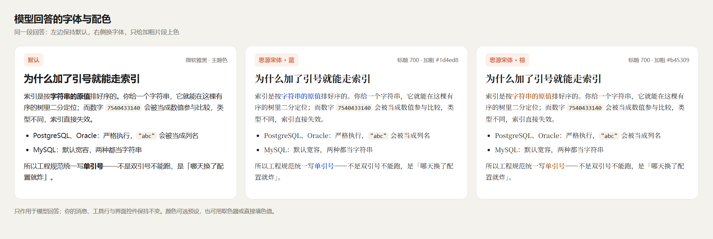
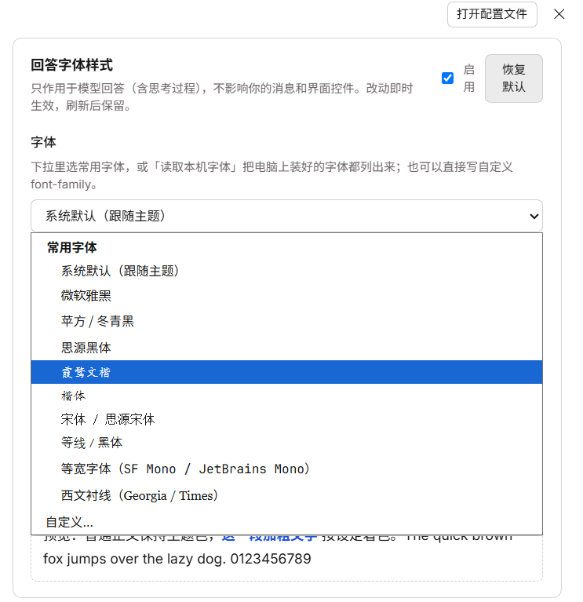

# dsh-answer-style · Answer Typography

[中文](README.md) | English

Restyle **only the model's answers** in DeepSeek Harness (DSH): font family, body and heading weight, and the color of the runs you choose — with a one-click reset. Your messages, tool rows and the rest of the UI stay untouched.

<p align="left">
  <a href="https://www.npmjs.com/package/dsh-answer-style"></a>
  
  
  
  
</p>

> Listed in the [dsh-market](https://github.com/dsh-market/dsh-market) plugin market — search `dsh-answer-style` · [listing](https://awesome-dsh-plugin.com/p/Luoqiaocong/dsh-answer-style/)

## Screenshots



Default on the left; on the right the same answer in Noto Serif SC with bolder headings and only the bold runs colored (blue `#1d4ed8` / brown `#b45309`).

| Settings | Font menu |
| --- | --- |
|  |  |

## Features

| Setting | What it does |
| --- | --- |
| Font | Grouped presets (Chinese system fonts, Latin system fonts, monospace, install-it-yourself open-source), the machine's installed fonts, or a custom `font-family` |
| Weight | Body and headings h1–h6 separately, following the theme by default |
| Color | Preset swatches, the native color picker, or a typed `#1d4ed8` / `rgb(…)`; pick which runs are colored: bold, headings, table headers |
| Switch | Enable/disable instantly; “恢复默认” clears every preference and removes the injected stylesheet |

The scope is the answer body (reasoning text, lists and tables included). Changes apply live, and the preference lives on the Host, shared by every browser and by DSH Desktop.

## Install

```sh
# Web (recommended)
dsh plugin --profile web add dsh-answer-style

# DSH Desktop
dsh plugin --profile desktop add dsh-answer-style

# or straight from GitHub
dsh plugin --profile web add github:Luoqiaocong/dsh-answer-style
```

Reload the page afterwards; if **Settings → 回答字体** is missing, restart `dsh web` once. Manual installation: see the [development docs](docs/development.md).

## Usage

1. Open **Settings → 回答字体**
2. Pick a font, tune the body and heading weights, choose a color for the runs you want to stand out
3. **Reset** restores the original look; “Follow theme” / “Default” restore one field at a time

## Compatibility

| Item | Detail |
| --- | --- |
| DSH | `0.2.2-rc.1` or newer (`dsh.engines.dsh`), the `0.2.x` line |
| Platform | Web (Chrome / Edge / Firefox / Safari) and DSH Desktop |
| OS | Windows / macOS / Linux; fonts follow the machine |
| Dependencies | none at runtime; no bundled fonts, no network, no telemetry |

## How it works

- It only touches `[data-chat-flow-kind="assistant-step"]` — the assistant row — so user messages and UI chrome are unaffected;
- Changes ride a single injected `<style>`; **reset removes it**, leaving nothing behind;
- The preference is stored by the Host in `~/.dsh/answer-style.json` (`$DSH_HOME` wins), shared across browsers and Desktop;
- Code blocks keep their own monospace font and color.

Selectors, the config file and the Host route are documented in the [design notes](docs/design.md).

## Limits

- Assistant answers only;
- Fonts must already be installed locally;
- If DSH changes the chat anchor or the markdown class naming, the selectors in `lib/client.js` need a matching tweak.

## Development

No build step — edit `lib/client.js`; `npm run check` runs the syntax check and the dependency-free smoke test. Releases go through GitHub Actions on `v*` tags. See the [development docs](docs/development.md).

## License

[MIT](LICENSE)
