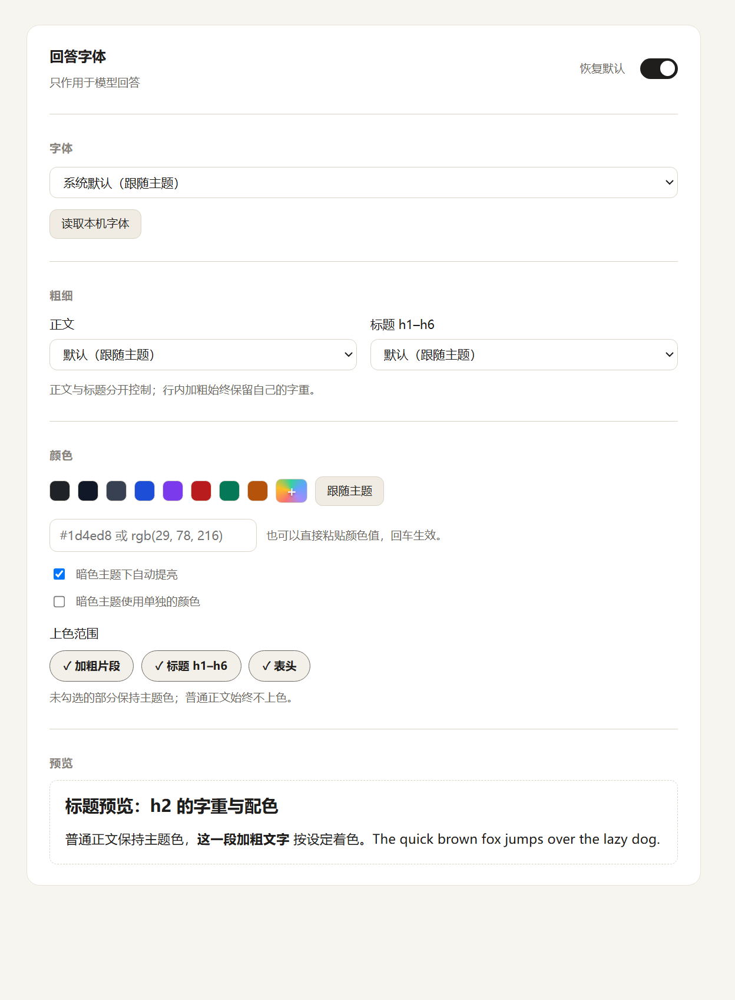
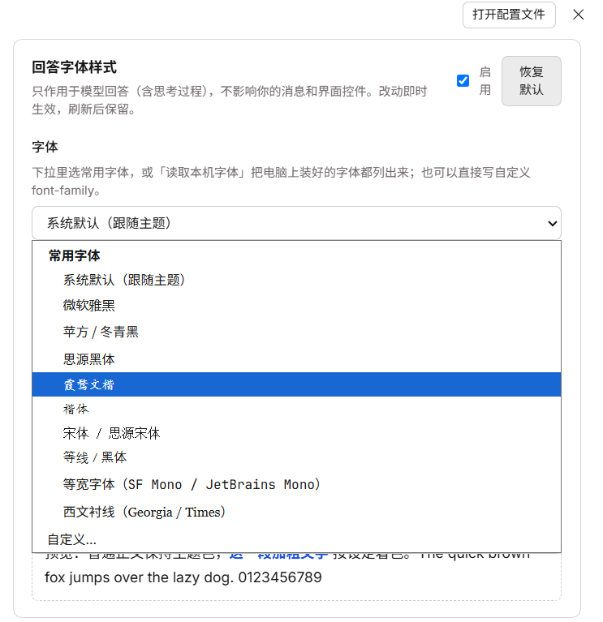

# dsh-answer-style · 回答字体

[English](README.en.md) | 中文

只改 **DeepSeek Harness（DSH）** 里「模型回答」的排版：字体、正文与标题字重、文字颜色（可选上色范围），随时一键恢复默认。你的消息、工具行和界面控件不受影响。

<p align="left">
  <a href="https://www.npmjs.com/package/dsh-answer-style"></a>
  
  
  
  
</p>

## 截图

| 设置页 | 字体下拉 |
| --- | --- |
|  |  |

## 功能

| 设置 | 说明 |
| --- | --- |
| 字体 | 分组预设：中文系统字体、西文系统字体、等宽、需自行安装的开源字体；也可读取本机已装字体，或自定义 `font-family` |
| 字重 | 正文与标题 h1–h6 各自独立，默认跟随主题 |
| 颜色 | 预设色块、系统取色器，或直接填 `#1d4ed8` / `rgb(…)`；上色范围可勾选：加粗片段、标题、表头。 |
| 开关 | 一键启用/停用；「恢复默认」清空全部偏好并移除注入样式 |

作用范围是模型回答的正文（含思考过程、列表与表格），改动即时生效，偏好保存在 Host，所有浏览器与桌面端共用。

## 安装

```sh
# Web（推荐）
dsh plugin --profile web add dsh-answer-style

# DSH Desktop
dsh plugin --profile desktop add dsh-answer-style

# 或直接从 GitHub 装
dsh plugin --profile web add github:Luoqiaocong/dsh-answer-style
```

装完刷新页面；设置里没有「回答字体」就重启一次 `dsh web`。手动安装见 [开发文档](docs/development.md)。

> 当前 `latest` 是稳定版 **0.2.7**（等同于 0.2.5 的功能）。**实验版** `0.3.0-beta.1` 带暗色主题自动适配，功能可能调整或移除，所以只放在 `beta` 标签：
>
> ```sh
> dsh plugin --profile web add dsh-answer-style@beta
> ```
>
> 只有明确需要暗色背景可读性时再装它。

## 使用

1. 打开 **设置 → 回答字体**
2. 选字体、调正文与标题字重、给需要强调的部分挑颜色
3. 想回到原样点「恢复默认」；单项还原用「跟随主题」/「默认」

## 兼容性

| 项目 | 说明 |
| --- | --- |
| DSH | `0.2.2-rc.1` 及以上（写在 `dsh.engines.dsh`，安装时校验），`0.2.x` 系列 |
| 平台 | Web（Chrome / Edge / Firefox / Safari）与 DSH Desktop |
| 系统 | Windows / macOS / Linux，字体以本机已安装的为准 |
| 依赖 | 无运行时依赖；不打包字体、不联网、不采集数据 |

## 原理

- 只作用于聊天中 `[data-chat-flow-kind="assistant-step"]` 这一行，所以用户消息与界面控件天然不受影响；
- 改动通过一个 `<style>` 注入，**恢复默认 = 删除它**，不留残留；
- 偏好由 Host 写在 `~/.dsh/answer-style.json`（设置了 `$DSH_HOME` 就用它），多浏览器与桌面端共用；
- 代码块保留自己的等宽字体与颜色，不会被覆盖。

实现细节（选择器、配置文件结构、配置路由）见 [设计说明](docs/design.md)。

## 限制

- 只覆盖模型回答，界面其他部分不变；
- 字体必须是本机已安装的字体；
- DSH 若调整聊天锚点或 Markdown 类名，需要同步改 `lib/client.js` 里的选择器。

## 开发

无需构建，改 `lib/client.js` 即可；`npm run check` 跑语法检查与零依赖冒烟测试。发布走 GitHub Actions（推 `v*` 标签）。详见 [开发文档](docs/development.md)。

## License

[MIT](LICENSE)
